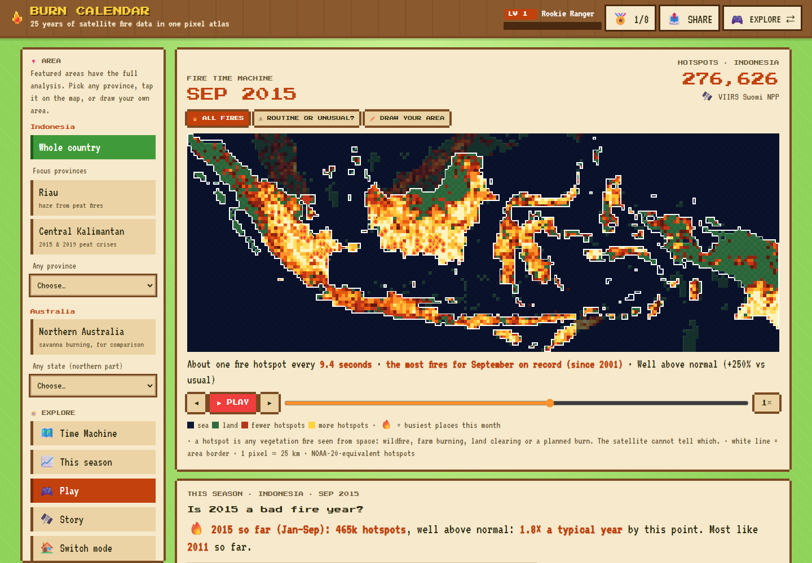
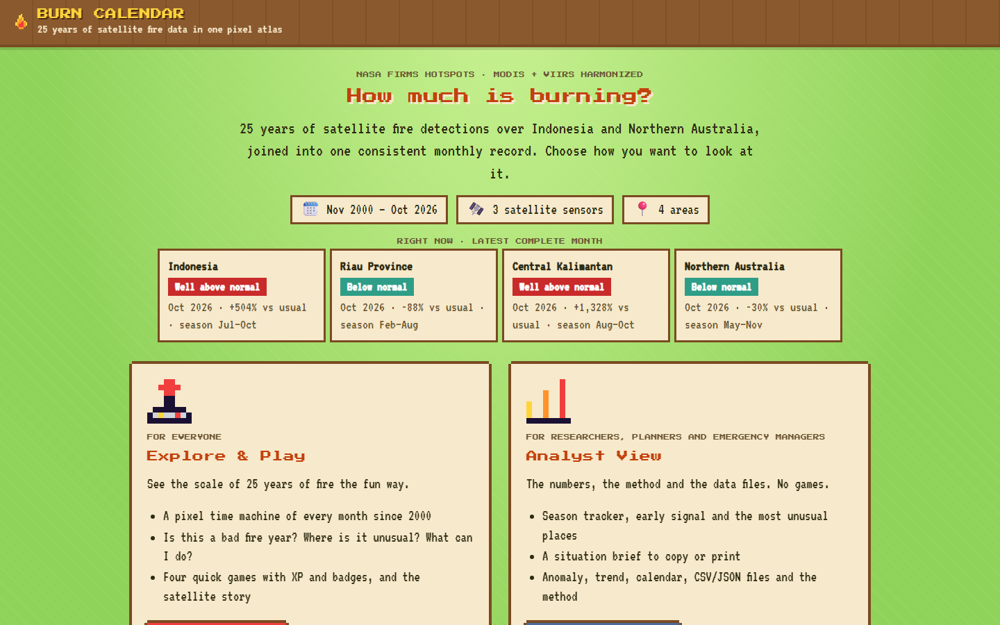
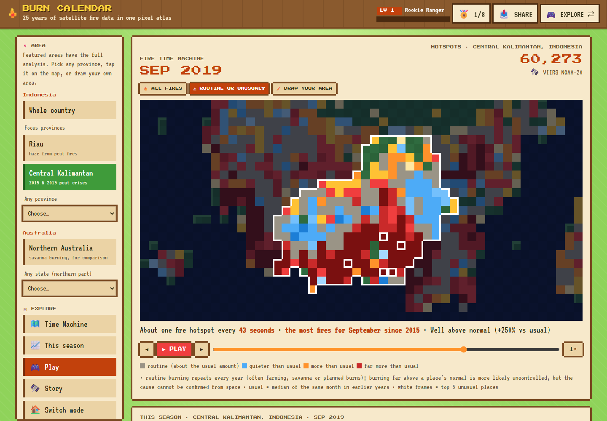
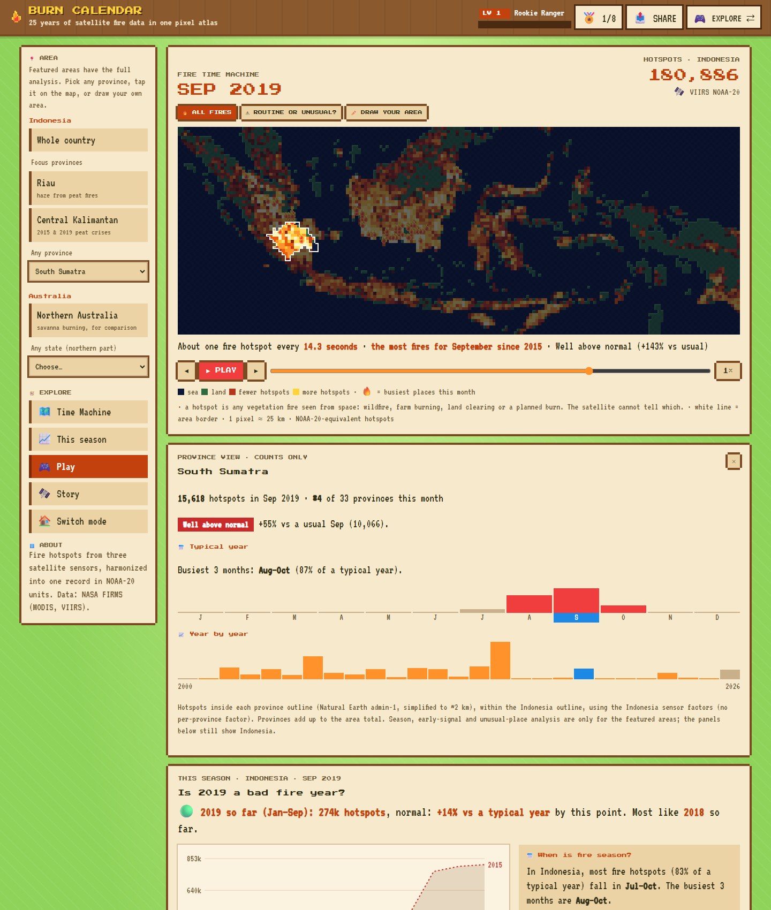
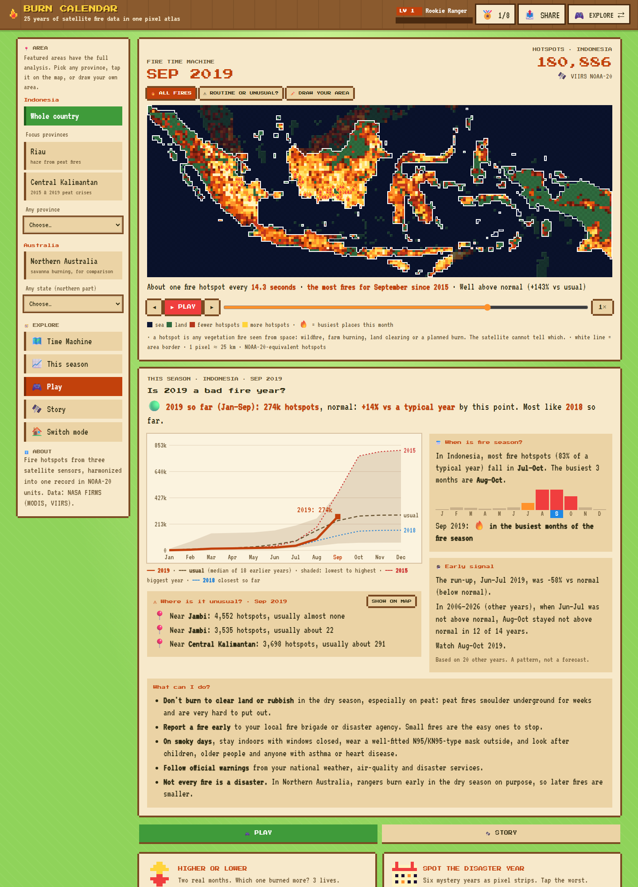
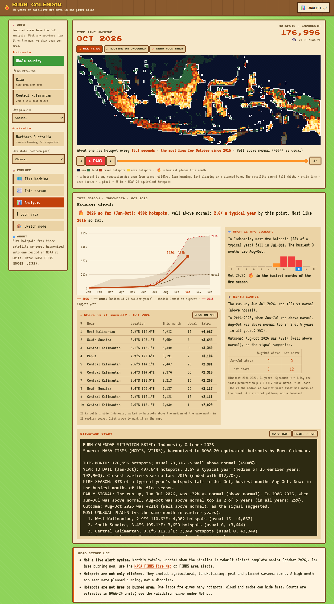
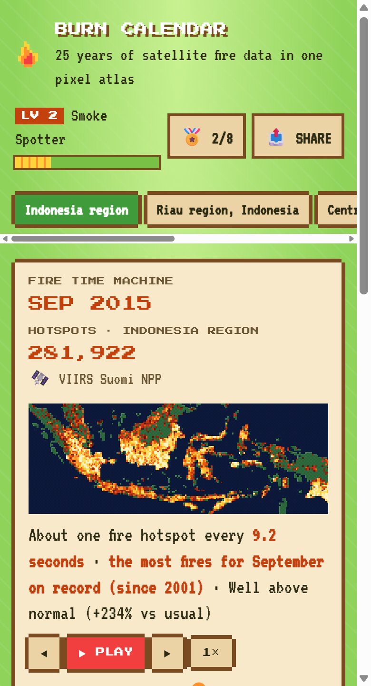
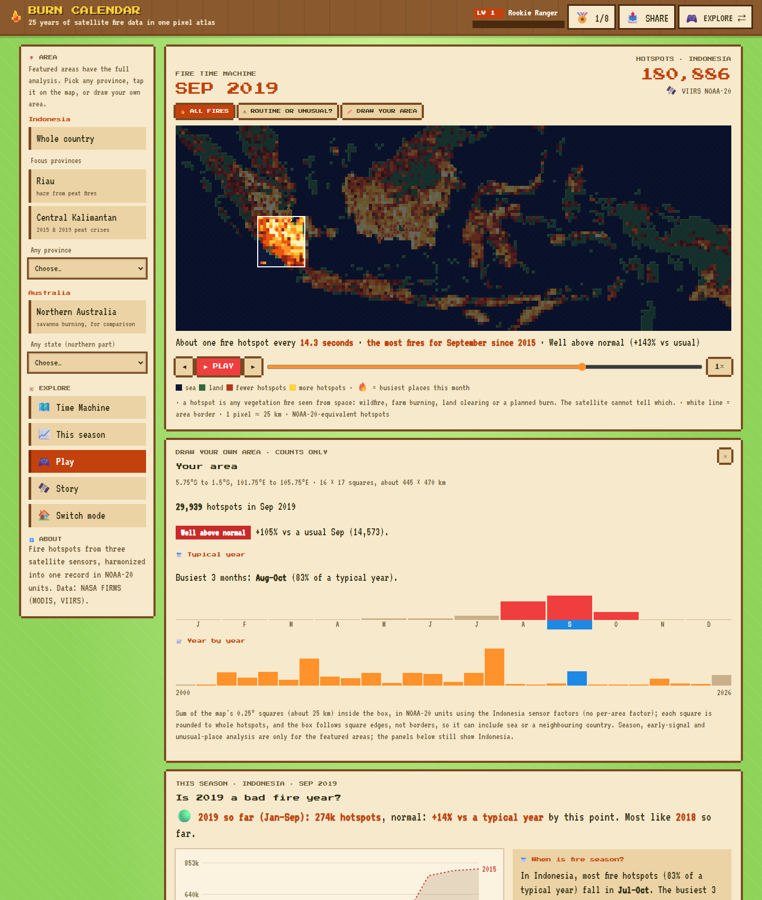

# Burn Calendar

NASA Space Apps 2026: *Harmonization of MODIS and VIIRS Hot Spots*.

Burn Calendar joins NASA FIRMS active-fire hotspots from three sensors (MODIS, VIIRS Suomi NPP,
VIIRS NOAA-20) into one monthly record in **NOAA-20-equivalent hotspots per month**, then shows it
as a pixel-art **Fire Atlas**. A home screen offers two modes:

- **Explore & Play** (public): a time machine map of 25 years of fire seasons, four games with XP and badges, and
  the story of the satellite handover.
- **Analyst View** (researchers, planners, emergency managers): the same map without games, plus the anomaly badge,
  Mann-Kendall trend test, burning-activity calendar, CSV download, open CSV/JSON file links, the method and
  validation, and a "read before use" note (monthly, not a live alert system; hotspots include planned and
  agricultural burns, not only wildfires).

**Live app:** https://alfanditora.github.io/burn-calendar/ (the static site lives in `docs/` and GitHub Pages
redeploys it on every push to `main`).



**Areas.** Four featured areas get the full analysis: Indonesia (whole country), two focus provinces (Riau: haze
from peat fires; Central Kalimantan: the 2015 and 2019 peat crises) and Northern Australia (savanna burning, for
comparison). Any other province or state can be opened from the area list or by tapping it on the map: the
province view shows its monthly hotspots, how this month compares with usual, its rank among provinces, its typical
year and its yearly totals. It uses the country's (or Northern Australia's) conversion factor, and leaves out
"usual" and busiest-month figures when the busiest month usually has fewer than 10 hotspots
(`PROVINCE_MIN_PEAK_MEDIAN`), because one or two fires would swing every percentage.

**Draw your own area.** Press "✏️ Draw your area" and drag a box on the map (or tap one square). The same panel then
shows that box's monthly hotspots in NOAA-20 units, this month against usual, its typical year, year-by-year totals
and a CSV. It is the sum of the map's 0.25° squares (about 25 km) inside the box, using the area's conversion
factor; the box follows square edges, not borders, so it can include sea or a neighbouring country. Share it with
`&box=west,south,east,north`, e.g. `?mode=analyst&area=indonesia&month=2019-09&box=101.75,-5.75,105.75,-1.5`
(southern Sumatra: 29,939 hotspots in Sep 2019, +105% vs a usual September).

Deep links work too, e.g. `?mode=analyst&area=riau&month=2015-09`, `?mode=explore&area=riau&tab=story`,
`?mode=explore&area=central_kalimantan&month=2019-09&layer=unusual` or `?mode=explore&province=South%20Sumatra`.

| | |
| --- | --- |
|  |  |
| **Home:** two modes and the latest month in every area | **Routine or unusual?** Central Kalimantan, Sep 2019 |
|  |  |
| **Any province:** South Sumatra, Sep 2019 | **This season:** tracker, fire season, early signal |
|  |  |
| **Analyst View:** calendar, trend, method, open data | **Phone** |
|  | |
| **Draw your own area:** southern Sumatra, Sep 2019 | |

More screenshots (Northern Australia, Riau 2015, games, story) are in `docs/screenshots/`. They were captured from
the live app with headless Chrome on Nov 14, 2026 and show real data only.

## Run it

```bash
python -m venv .venv
.venv/Scripts/pip install -r requirements.txt     # macOS/Linux: .venv/bin/pip
python pipeline/fetch_firms.py --region indonesia  # download FIRMS history via the area API (needs FIRMS_MAP_KEY)
python pipeline/fetch_firms.py --region north_australia
python pipeline/inspect_raw.py                     # list data/raw files and print their headers
python pipeline/run_all.py                         # rebuild everything in data/processed from data/raw
python pipeline/insights.py                        # optional fast path: recompute season/early signal/cell names
                                                   # over existing outputs (no raw data needed; run_all does this too)
python -m pytest                                   # tests run on the SYNTHETIC files in data/sample
```

`data/raw/` holds FIRMS CSVs (not committed): either API chunks written by `fetch_firms.py` under
`data/raw/firms_api/` or Archive Download files. Both formats load the same way. Any file names work. The sensor is
read from the `satellite` column, and SP vs NRT comes from the `version` column or "nrt" in the file name.
The FIRMS API key, if it is used, is read from the `FIRMS_MAP_KEY` environment variable and is never committed.

## Pipeline

| Step | File | What it does |
| --- | --- | --- |
| Download | `pipeline/fetch_firms.py` | Area API in 5-day chunks for one box; resumable, rate-limit aware, SP first then NRT |
| Settings | `pipeline/config.py` | Areas, thresholds, overlap years: every choice that changes results |
| Load | `pipeline/load.py` | Normalise columns, map satellites to MODIS/SNPP/NOAA20, drop low confidence, prefer SP over NRT |
| Borders | `pipeline/regions.py` | Builds `data/external/regions.geojson` (real outlines) and `admin1.geojson` (province/state names) from Natural Earth 1:10m admin-1 |
| Bin | `pipeline/bin.py` | Monthly counts per area (inside its real border) and sensor, zero-filled only in fully covered months |
| Calibrate | `pipeline/calibrate.py` | Ratio factors on overlap years, drift check, stability, hold-out validation, harmonized series |
| Trend | `pipeline/trend.py` | Mann-Kendall + Sen's slope (yearly and seasonal), anomaly vs median of earlier years |
| Insights | `pipeline/insights.py` | Fire-season months, busiest months, and the early-signal hindcast (does an above-normal run-up predict an above-normal peak?) |
| Export | `pipeline/export.py` | `monthly_counts.csv`, `areas/{id}.json` + `.csv`, `areas/index.json` |
| Pixel map | `pipeline/grid.py` | Harmonized counts per 0.25° cell and month + land mask + province name per cell, `grid/{region}.json` for the Time Machine |
| Provinces | `pipeline/grid.py` | Monthly harmonized hotspots per province/state (point in outline, same points and factor as the area), `grid/{region}_provinces.json`; provinces add up to the area total |

### Notes on the monthly_counts table

There is one row per area, month and sensor. `harmonized_count` is that sensor's count converted to
NOAA-20 units. `source_used` names the sensor chosen for the month (NOAA-20, else SNPP, else MODIS),
so the row where `sensor == source_used` is the calendar value. `pct_rank_within_sensor` is the
percentile fallback, which ranks a month within the same calendar month of its own sensor.

## Results (run of Nov 14, 2026)

Areas are counted inside their real borders (Natural Earth 1:10m). For each link: the factor, the **cross-validated
error** (each overlap year held out in turn, errors weighted by fire counts; monthly / yearly) and the brief's
**last-2-years** check (monthly MAPE on 2024–2025):

| Area | MODIS → Suomi NPP | Cross-validated | Last 2 yrs | Suomi NPP → NOAA-20 | Cross-validated | Last 2 yrs | Notes |
| --- | --- | --- | --- | --- | --- | --- | --- |
| Indonesia | 5.10 | **10.9%** / 6.7% | 19.9% | 1.01 | **4.9%** / 4.1% | 8.2% | drift 3.4% |
| Riau Province, Indonesia | 5.10 (from Indonesia; own 4.87 unstable) | **21.5%** / 16.3% | 156.7% | 1.02 | **9.2%** / 4.7% | 13.8% | drift 34.6% |
| Central Kalimantan, Indonesia | 5.10 (from Indonesia; own 5.05 unstable) | **16.3%** / 12.3% | 52.4% | 0.99 | **5.5%** / 3.3% | 19.5% | drift 9.6% |
| Northern Australia | 4.52 | **7.6%** / 3.4% | 12.1% | 0.99 | **4.9%** / 4.0% | 5.7% | drift 1.6% |

- VIIRS detects about **4.5–5.1× more hotspots than MODIS** over the same land, and the two VIIRS sensors agree within
  about 2%. The factors are close in two very different fire regimes: Indonesian peat and forest clearing, and
  Australian savanna burning. That supports one conversion chain for both.
- **Headline validation error** (worse link, cross-validated): Indonesia 10.9%, Riau 21.5%, Central Kalimantan 16.3%,
  Northern Australia 7.6%.
- **Small provinces:** on their own, Riau's and Central Kalimantan's MODIS→VIIRS ratios swing from year to year
  (few fires in recent years), so they use Indonesia's factor (5.10), which is close to their own (4.87, 5.05) and
  validates slightly better. The last-2-years check looks much worse for them (157%, 52%) because 2024–2025 were
  quiet years: Riau had about 3,000 hotspots a year then, against 117,000 at its peak, and percentage errors on
  small counts explode. The cross-validated error weights every year by its fires and is the fairer measure.

Trend (Mann-Kendall on yearly totals 2001–2025) and the latest complete month (Oct 2026, near-real-time data):

| Area | Long-term trend | Oct 2026 vs median of earlier Octobers |
| --- | --- | --- |
| Indonesia | falling (p = 0.018, Sen's slope -11,151/yr) | Well above normal (+504%) |
| Riau Province, Indonesia | falling (p = 0.004, Sen's slope -1,963/yr) | Below normal (-88%) |
| Central Kalimantan, Indonesia | falling (p = 0.008, Sen's slope -1,872/yr) | Well above normal (+1328%) |
| Northern Australia | no clear trend (p = 0.944, Sen's slope -246/yr) | Below normal (-30%) |

All three sensors independently show the 2026 Indonesian fire season (Aug–Oct); for Indonesia, October 2026 is the
highest October since 2015. The largest year in the record is 2015 (the Southeast Asian haze crisis).

**Why real borders matter:** with a rectangle around Riau, October 2026 looked "Well above normal" (+86%), because
the box also caught fires in neighbouring Jambi, West Sumatra and North Sumatra. Inside Riau Province's real border
the same month is "Below normal" (−88%).

### From data to decisions: season, early signal, unusual places

The app does not stop at "what happened". For the month on the map it answers: is this year running ahead of
normal (season tracker against the median, lowest and highest earlier years, plus the closest earlier year)? When is
the fire season? Where is it unusual (25 km cells most above their own median for that month, named by province)?
And does the run-up tell us anything about the peak?

**Routine or unusual, not wildfire or not.** A FIRMS hotspot is any vegetation fire; the data cannot say whether it is a
wildfire, farm burning, land clearing or a planned burn. So the map never labels a cause. Instead the "Routine or
unusual?" layer greys out cells burning 50–150% of their usual amount for that month (the same burning repeats every
year: often farming, savanna or planned burns) and colours cells above or below that. A cell at 2× its usual or
more is called "far above normal: more likely an uncontrolled fire". The 🔥 flames on the main map only mark the
busiest cells of the month (more than half the top of the colour scale), not wildfires. Land-cover and peatland
overlays would narrow down causes and are listed as next steps.

**Early signal (hindcast, 2006–2026):** the "run-up" is the 2 months before the 3 busiest months. Each window is
compared with the median of the same window in *earlier* complete years only (what was known at the time); above
normal = at least +15%. Settings are in `config.py`.

| Area | Most hotspots fall in | Busiest months | Run-up | Run-up above → peak above | Run-up not above → peak not above | Peak above, all years | Spearman ρ (p) | 2026: run-up → peak |
| --- | --- | --- | --- | --- | --- | --- | --- | --- |
| Indonesia | Jul–Oct (83%) | Aug–Oct | Jun–Jul | 3 of 6 | 12 of 15 | 29% | 0.76 (< 0.001) | +32% → +221% |
| Riau Province, Indonesia | Feb–Aug (81%) | Jul–Sep | May–Jun | 5 of 5 | 13 of 16 | 38% | 0.76 (< 0.001) | −92% → −82% |
| Central Kalimantan, Indonesia | Aug–Oct (93%) | Aug–Oct | Jun–Jul | 4 of 5 | 14 of 16 | 29% | 0.86 (< 0.001) | +123% → +572% |
| Northern Australia | May–Nov (88%) | Sep–Nov | Jul–Aug | 4 of 5 | 12 of 15 | 35% | 0.44 (0.026) | +34% → *pending* |

- In every area, run-up and peak are clearly correlated (one-sided permutation test, 10,000 shuffles). A quiet
  run-up is the more reliable message (12–14 of 15–16 years stayed not above normal); an above-normal run-up raises
  the chance of an above-normal peak to roughly 2–3 times the base rate, but it misses too (Indonesia: 3 of 6).
- It also misses the other way: Riau's 2015 run-up (May–Jun) was −70%, yet Jul–Sep 2015 was +47%. The app shows
  such misses instead of hiding them.
- **Live call:** Northern Australia's Jul–Aug 2026 was +34% above normal; Sep–Nov 2026 is not complete yet.
- We chose a 3-month peak (not 2) because a 2-month window put Riau's peak at Jul–Aug and left out September; the
  2-month version gave similar or stronger correlations for Indonesia and Northern Australia (ρ 0.60), so this choice
  was not made to improve the numbers. In the app, the counts shown for a year leave that year out.
- This is a historical pattern from ~20 years, not a forecast model; it ignores weather and climate drivers.

## Future development

- **AI plain-language situation brief.** Today the brief is a template filled from the computed numbers, so every
  figure is traceable. Next: generate a plain-language version at build time (not in the browser, so no API key is
  exposed), check automatically that every number in it appears in the template brief (the build fails otherwise),
  label it as AI-written next to the template figures, and list it under "Use of SI tools".
- **Full analysis for every province.** The province view now covers all provinces with counts only. Next: run the
  whole pipeline per province (own MODIS→VIIRS factor where the link is stable, parent fallback otherwise, validation,
  season and early-signal hindcast), with the minimum-hotspot rule for small provinces, and current
  province borders (Natural Earth has 33 Indonesian provinces: no North Kalimantan, split off in 2012, and none of
  the 2022 Papua provinces; Indonesia now has 38).
- **Cause context.** Land-cover (MODIS MCD12Q1) and peatland overlays to separate likely farm burning from forest
  and peat fires.

## Limits

- Converted counts are estimates; a single ratio per area cannot capture every seasonal or regional difference.
- Hotspots are fire detections, not burned area. Small, short or cloud-covered fires can be missed.
- Hotspots are not only wildfires: they include agricultural, land-clearing, peat and planned (prescribed) burns.
  "Routine or unusual" is the closest the data allows. Next step: a land-cover (MODIS MCD12Q1) and peatland
  overlay to separate likely farm burning from forest and peat fires.
- Burn Calendar is a monthly record for planning and research, not a live alert system; for active fires use the
  NASA FIRMS Fire Map.
- The early signal is a historical pattern over about 20 years, not a forecast.
- The province view uses Natural Earth's 33 Indonesian provinces (North Kalimantan is inside East Kalimantan; Papua
  before the 2022 split) and the country's
  conversion factor, not a per-province one; outlines are simplified to about 2 km, so hotspots right on a provincial
  border can land in the neighbour.
- Borders come from Natural Earth 1:10m; Northern Australia is defined as Australian land north of 20°S (121–146°E).
- The latest months use near-real-time data, which FIRMS replaces with standard data after about 5 months.
- Static sources are removed with FIRMS type flags (standard data) and a 0.05° mask (near-real-time data).

## Decisions and differences from the plan

- **The area API now allows at most 5 days per call** (`Invalid day range. Expects [1..5]`, checked
  Nov 14, 2026), not 10 as in the plan. It still serves the full SP history, so we download through
  the API in 5-day chunks instead of using the Archive Download.
- **Data availability on Nov 14, 2026** (FIRMS `data_availability`): standard (SP) data runs to
  Jul 31, 2026 for VIIRS and Aug 31, 2026 for MODIS. Later months come from NRT.
- **Volcanoes, gas flares and offshore sources are removed.** SP files mark each detection with a
  `type` (0 vegetation fire, 1 volcano, 2 other static source such as gas flares, 3 offshore), and we
  keep type 0 only. NRT files have no `type`, so an NRT detection is dropped if it falls in a 0.05° cell
  where SP data ever flagged a type 1/2/3 source. The same rule applies to every sensor, so the chain
  stays consistent. In the Indonesia box for Sep 2015, about 12% of MODIS detections were flagged as static.

## Sources

- NASA FIRMS Archive Download: https://firms.modaps.eosdis.nasa.gov/download/
- NASA FIRMS area API: https://firms.modaps.eosdis.nasa.gov/api/area/
- Sensor coverage: MODIS C6.1 from 1 Nov 2000; VIIRS Suomi NPP from 20 Jan 2012 to 2 Nov 2026; VIIRS NOAA-20 from 1 Apr 2018.

## References

Data
- NASA FIRMS active fire data: MODIS Collection 6.1 (MODIS_SP, MODIS_NRT), VIIRS Suomi NPP 375 m
  (VIIRS_SNPP_SP, VIIRS_SNPP_NRT), VIIRS NOAA-20 375 m (VIIRS_NOAA20_SP, VIIRS_NOAA20_NRT).
  Data: NASA FIRMS (MODIS, VIIRS). https://firms.modaps.eosdis.nasa.gov/

Libraries (open source)
- pandas: https://pandas.pydata.org/ (BSD-3)
- NumPy: https://numpy.org/ (BSD-3)
- pyarrow: https://arrow.apache.org/ (Apache-2.0)
- pymannkendall 1.4.3: Hussain & Mahmud (2019), JOSS 4(39), 1556 (MIT)
- requests: https://requests.readthedocs.io/ (Apache-2.0)
- pytest: https://pytest.org/ (MIT)
- shapely: https://shapely.readthedocs.io/ (BSD-3), to rasterise the land mask

Other data and assets
- Natural Earth 1:50m land polygons (public domain): https://www.naturalearthdata.com/, for the pixel map land mask
- Natural Earth 1:10m admin-1 states and provinces (public domain), for the area borders
- Fonts: Press Start 2P (CodeMan38) and VT323 (Peter Hull), SIL Open Font License, served by Google Fonts
- Pixel sprites (flames, satellites, icons) are drawn in code in `docs/js/sprites.js`; no external images are used

## Use of SI tools

Code in this repository was generated with assistance from Claude Code (Anthropic), working from
the team's written plan and brief. Each code file carries a header saying so. The team reviewed the
code, the method choices (thresholds, overlap years, the static-source filter) and the outputs.
Synthetic test data in `data/sample/` was generated by a script and is never shown in the app.
